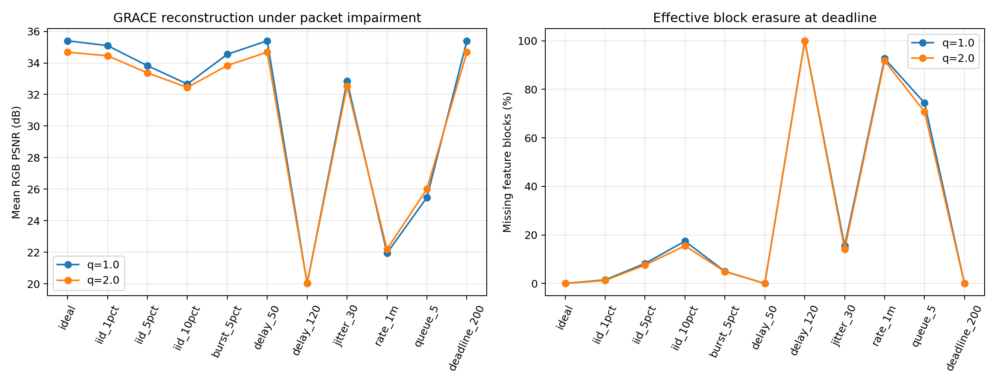

# GRACE / AITestbed 特征块传输与 PSNR 预测实验

2026-10-12。已实现并运行真实 GRACE 权重、十块独立压缩、RTP 分片、逐包网络扰动、部分特征恢复和帧级 PSNR 预测。结果支持进一步研究两段映射，但目前只是低分辨率、短片段探索性实验；不能据此声称公网部署或分布变化下稳定有效。

## 实验口径

- GRACE commit `14f1721663acd5d16ca776ce61b4a5860167d24d`，4096 checkpoint，FP32，scale=1；逐参数核对权重加载。源码及权重独立获取，不再分发。
- 12 个 StreamingBench 现有视频，每个取第 10 秒起 16 帧，按 30 fps 采样，缩放到 256×192；GOP=8，JPEG I 帧保证完整交付，P 帧没有 I-patch。源侧和接收侧独立维护参考。
- `q=1/2` 是残差量化步长，不是传统 QP。十块符号交织，每块独立 DEFLATE 熵压缩、CRC 校验、1200-byte RTP 分片，任一片失败整块置零。它补齐上游没有提供的熵解码，不复现论文学习熵编码码率。
- 11 种虚拟网络 × 3 seeds × 12 视频 × 14 P 帧 × 2 个 q，共 **11,088 条逐包网络标签**；另外固定 GOP 掩码、20%/50% 丢块各 504 条，共 **12,096 条 P 帧标签**。48 条 I 帧质量标签单独保存。大量样本来自虚拟 FIFO，不是大量真实公网抓包。
- 用户指定的官方 5G-MAG/6G-Testbed main 固定到 `7231ae8e5670b67564cf28d397c2820d9403ecdc`，使用普通 aiortc 1.14.0，最终验证四种 profile、每种 7 个 P 帧，共 28 帧。此前会话本地 fork 的三个诊断轮次、额外 84 帧单独保留。真实网络预检全部来自视频 1 的第一个 GOP，不作统计泛化依据。
- RGB 像素归一化到 [0,1]，逐帧 `PSNR=-10log10(MSE)`。只对解码像素 clip；分数不人为截断。配对网络特征**只看帧截止前可见包**。延迟导致的未及时交付与最终物理丢包分别报告。

## 网络如何改变质量

以下为 q=1，每种 504 个 P 帧，默认 100 ms 播放预算。均值是帧级 dB 的算术平均，不是整批 MSE 的 PSNR。

| 条件 | 最终包丢弃率，按包计 | 超时包比例 | 坏块比例，按帧平均 | 平均 PSNR |
|---|---:|---:|---:|---:|
| 无扰动 | 0% | 0% | 0% | 35.40 dB |
| IID 包丢失 1% | 0.87% | 0% | 1.49% | 35.10 dB |
| IID 包丢失 5% | 4.98% | 0% | 8.23% | 33.83 dB |
| IID 包丢失 10% | 10.72% | 0% | 17.44% | 32.66 dB |
| 5% Markov 突发丢失，平均坏串=5 包 | 4.31% | 0% | 4.98% | 34.55 dB |
| 固定延迟 50 ms | 0% | 0% | 0% | 35.40 dB |
| 固定延迟 120 ms | 0% | 100% | 100% | 20.02 dB |
| 延迟 60 ms、正态抖动 σ=30 ms | 0% | 9.37% | 15.46% | 32.85 dB |
| 1 Mbit/s、无限队列 | 0% | 93.12% | 92.68% | 21.94 dB |
| 1 Mbit/s、队列上限 5 包 | 74.27% | 0% | 74.40% | 25.47 dB |
| 相同 60±30 ms 延迟、预算增至 200 ms | 0% | 0% | 0% | 35.40 dB |

包失败被整块完整性放大。q=1 平均每个 P 帧约 17.05 个 RTP 包、13,946 字节 IPv4/UDP/RTP 数据；这里没有 SRTP 标签，也不含免扰动的 I 帧。按 30 fps 连续 P 帧折算约 3.35 Mbit/s，考虑本次 I/P 比例后 P 流量约 2.93 Mbit/s，故 1 Mbit/s 是明确过载条件。队列过大可将许多帧拖过截止；小队列在此实验中虽增加立即丢弃，却减轻持续积压。不能推广为“越小队列越好”。

相同平均包丢失率不决定块掩码。这里按块依次发送分片，突发丢失倾向集中破坏少数块，因此平均坏块率可能低于 IID；其他包序、分块和时间相关性可以改变这个结论。

无扰动 q=2 为 34.68 dB，低于 q=1 的 35.40 dB，但平均 P 帧字节也降低到约 13,035。没有进行等实际码率校准，不能称为同码率优劣比较。固定 GOP 掩码标定中，20% 和 50% 坏块的平均 PSNR 为 32.12 和 28.99 dB；这组不能替代真实逐包变化的掩码历史。

## 真实 SRTP / 原 Testbed netemu

下表为官方 main 接入可靠布局并使用原 TrafficLogger 的一轮，文件前缀为 `official_netem_`。播放预算 200 ms，配置保留官方原 profile，原始 netem 的分布、相关性、重复和重排不简化为虚拟 profile。`final_netem_`、`aitestbed_netem_`、`rtc_netem_` 为此前 fork 的诊断，不能当作官方结果；其中 `lossy` 也不是本次官方 main 的 profile。

| profile | RTP 发送/最终接收 | 平均坏块比例 | 平均 PSNR |
|---|---:|---:|---:|
| no_emulation | 84/84 | 0% | 38.12 dB |
| 5g_urban | 84/84 | 0% | 38.12 dB |
| 5qi_7 | 84/84 | 0% | 38.12 dB |
| congested | 84/32 | 90.00% | 28.23 dB |

所有 I 帧先通过可靠有序 DataChannel 完整交付并校验，随后才启用 netemu。无扰动七帧的特征字节 SHA-256 全部匹配；收端使用可靠传到的 shape、length 和帧时限重组/解码。所有抓包中的目标 SSRC/PT 序号集合与应用实际回调集合一致。拥塞诊断早期曾有一包在 drain 后、关闭 transport 时才进入回调，已保留 drain 计数并用最终事件列表核准最终接收数，未改动质量标签。

本接收器明确不发送 NACK、不使用 RTX。普通 aiortc 默认视频 codec 支持 NACK/RTX，接收器有 NACK 路径；实际重传取决于反馈、协商与发送历史。普通 1.14.0 的 `_retransmit` 在协商 RTX 时包装 RTX，未协商 RTX 时仍能发历史原 RTP 包；此前本地 fork 的发送语句则位于 RTX 条件分支内。普通 jitter buffer 缺包会停止扫描，下一 timestamp 才触发前帧递交，marker 本身不触发完整帧递交；只有此前 fork 的 token 分支会跳过缺槽。新实现用明确截止时间恢复部分块，不借用默认整帧门槛。详见[源码路径及协议分析](../docs/design_zh.md)。

真实 endpoints 共宿主，ICE/DTLS/SRTP 经过独立 Linux namespace 的 lo；图像编码预先缓存，神经解码在网络 drain 后离线进行。未验证跨主机时钟同步或实时逐帧解码调度。宿主网卡没有修改，namespace 已删除，内部 lo 清理为 noqueue。

## PSNR 预测结果

训练视频 1–8，验证 9–10，测试 11–12；所有 q、网络条件、GOP、种子按视频归组。训练/验证/测试为 7,392 / 1,848 / 1,848 条逐包样本；固定掩码样本没有混入预测训练。**测试实际上只有两个独立视频**，不能把 1,848 行当成 1,848 个独立信源。

网络输入为截止前的包数/字节、未及时观测比例、延迟均值/95 分位/标准差、帧内间隔标准差、最大包长，加已知协议上下文 GOP 位置、q、deadline。不读取 profile 名称、真实坏块率/掩码、PSNR、迟到后才出现的包或 final_capture_loss。第一段预测十位坏块概率；第二段用预测概率及累计/前帧历史预测 PSNR。源反馈增强模型另加 SI/TI，或 GRACE 量化后 motion/residual 的绝对均值、RMS、非零比例。

| 方法 | 测试 MAE | 测试 RMSE |
|---|---:|---:|
| 训练集均值 | 5.09 dB | 6.01 dB |
| 仅上游可见字节/包数＋已知协议配置 | 4.79 dB | 6.06 dB |
| 仅截止前包缺失比例 | 2.23 dB | 3.02 dB |
| 配对抓包直接回归 | 2.29 dB | 2.90 dB |
| 配对抓包两段回归 | **1.43 dB** | **1.92 dB** |
| 两段＋源侧 SI/TI 反馈 | 2.69 dB | 3.00 dB |
| 两段＋SI/TI＋GRACE latent 反馈 | 2.78 dB | 3.11 dB |
| 已知真实块掩码的应用模型 | 1.49 dB | 2.04 dB |

这些都是探索性对照。源反馈方案在验证与测试上的表现不同；按验证集选择更复杂的反馈模型，未保证测试更好。需要更多独立信源、特征约束和预注册外测，不能挑测试最好的一行宣称普适最优。已知掩码模型是诊断参照，有限模型的误差不是数学上界；概率平滑也可能偶然比输入真实硬掩码的模型泛化更好。

两段模型的特征丢失估计与应用失真映射可以分开检查，因而有利于诊断；但仅上游抓包不能辨识发生在观察点下游的损失。SRTP 的加密载荷也不会向旁路节点暴露本实验的块头。配对抓包结论依赖同步的收发观察，带 SI/TI/latent 的结果依赖显式反馈，两者均不能直接称为“任意网络点纯被动预测”。

本次没有验证 TTA。无实时 PSNR 标签时，分类式熵最小化不能直接提供 PSNR 回归监督。优先考虑用接收块状态反馈在线校准第一段；第二段冻结主体、低频质量锚点校准，并进行先预测再适配的时序外测、退化报警和回滚。

## 验证、速度与交付

此前 fork 运行时 15 项本地测试通过；最终普通 aiortc 运行时 14 项通过、1 项 fork 独有 token 分支检查明确跳过，包括真实 SRTP 往返、I 帧可靠数据、整块丢失/CRC、乱序重复、全丢、序号回绕、队列跨帧、截止前因果特征。12,096 行无重复实验键，PSNR 均有限，掩码与坏块率一致；无扰动与干净参考最大差约 0.0004 dB，来自 GPU 数值误差。因果特征从原事件重新提取，质量/掩码标签哈希保持不变。逐帧推理固定树累加顺序，避免每帧创建线程池及概率边界数值波动；状态式单帧预测与批量预测通过全部 3,696 行留出样本对照。两种 aiortc 对全部 336 个缓存 P 帧生成的 5,410 个 RTP 包字节哈希一致，故虚拟网络标签无需因运行时切换重算。

RTX 3070、256×192、FP32、batch=1、5 次预热后 20 次串行同帧微基准：神经编码均值 14.17 ms、解码 6.23 ms、DEFLATE 编码 3.13 ms、解码 0.25 ms；CUDA 已同步，包含 CPU/GPU 数据搬运。这不包括网络、采集、排队和在线流水线，不能直接换算为端到端实时 FPS。

公开内容包括可复现代码、配置、逐帧标签、I 帧标签、源/特征哈希、压缩包事件、预测逐行结果、pcap 包头与哈希、tc 统计、测试和微基准。原始视频/帧、权重、PCAP、SQLite 及本机模型缓存不公开。

下一步依次扩展独立视频/场景和片段长度、720p/1080p、不同 GOP 与块大小、严格等实际码率传统 H.264/H.265 对照、有限期重传/PLI 对照、跨主机与可见元数据方案，再开展时变信源上的预顺序在线适配。当前尚未完成这些扩展；现有结果只证明原型链条可运行并揭示初步规律。
